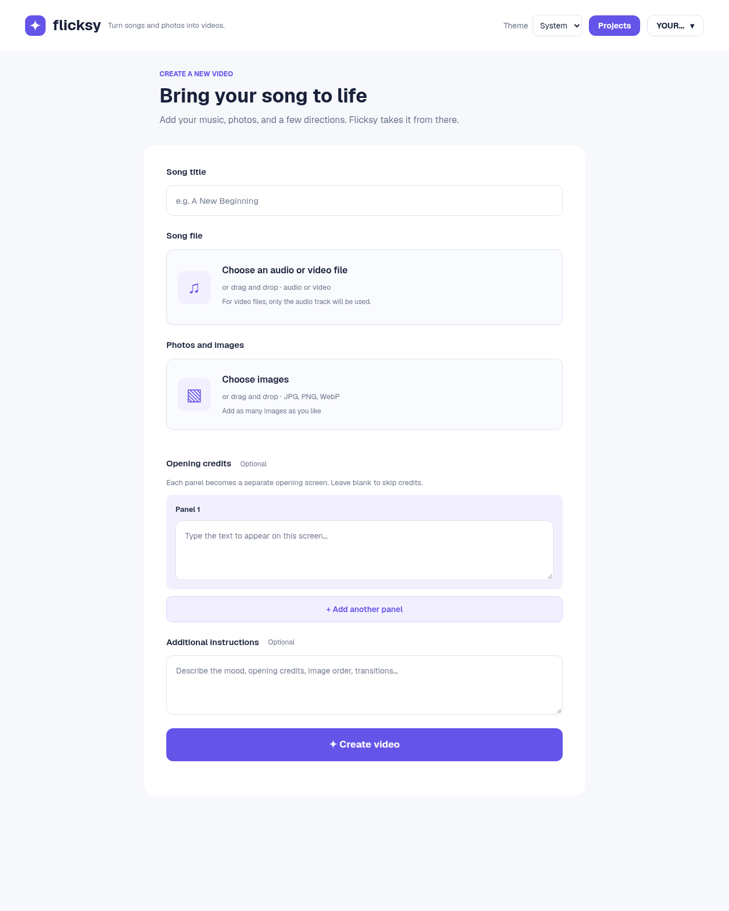

# Flicksy

Flicksy turns music and photos into videos. A language-model agent plans and
runs FFmpeg commands to combine your audio, images, opening credits, and creative
instructions. You can preview and download successive renders, and optionally
upload them to YouTube.

> **Experimental: trusted users only.** Flicksy executes LLM-generated shell
> commands with the server user's privileges. The project working directory is
> not a sandbox: commands can access other projects, the account database,
> credentials, mounted files, and the network. User accounts do **not** isolate
> rendering jobs from one another. Run Flicksy in a dedicated environment with
> only trusted users and inputs; do not expose it as an untrusted multi-tenant
> service. The non-root Docker container does not isolate individual renders.
> Cancelling production stops the agent loop, but an already launched command
> may continue running.



## Requirements

The supported deployment target is **Linux**. The source build and checks have
been tested with **Rust/Cargo 1.99.1** and **Topcoat CLI 0.11.0**. Other platforms
and older toolchains are not currently verified. Docker is an alternative to
installing the native runtime tools; see [docker/README.md](docker/README.md).

For a native installation, provide:

- Rust and Cargo with edition 2024 support; start with the tested version above.
- A C/C++ compiler, linker, CMake, and pkg-config for native build dependencies.
  SQLite is built from the bundled source; a separate SQLite server is not needed.
- `ffmpeg` and `ffprobe` (the current container uses Arch Linux's recent FFmpeg),
  ImageMagick with Pango support, Fontconfig (`fc-match`), DejaVu and Noto fonts,
  Python 3 (`python3`), jq, and a POSIX shell. Install Noto Sans Malayalam if you
  use Malayalam credits. Render results depend on available codecs, filters,
  fonts, and the model; older FFmpeg packages may behave differently.
- `stty` and an interactive terminal for the hidden account-password prompt.
- An OpenAI-compatible chat-completions endpoint and a model that supports
  structured tool/function calls. Configure its exact model ID; a text-only chat
  model or endpoint without tool calling is not sufficient.

On Arch Linux, the native dependencies can be installed with:

```sh
sudo pacman -S --needed base-devel cmake pkgconf ffmpeg imagemagick \
  fontconfig ttf-dejavu noto-fonts python jq
```

Adapt package names to your distribution. ImageMagick's `PANGO` format and the
fonts used for credits must be available. The build downloads the standalone
Tailwind CLI on first use, so a fresh build needs network access in addition to
Cargo's crate downloads. The UI currently loads Geist fonts from jsDelivr in the
browser.

## Quick start from source

Run these commands from the project checkout:

```sh
cargo install topcoat-cli --version 0.11.0 --locked
cp config.example.toml config.toml
```

Edit `config.toml` before proceeding:

- Replace `[llm] base_url` and `model` placeholders with your endpoint and model ID.
- If needed, configure `api_key_env` or `api_key_file`. An environment variable
  takes precedence over a file. Flicksy does not automatically load `.env` files.
- Set `[operator] contact_email` to your installation's public contact address.
  This is displayed as text and a `mailto:` link on `/privacy` and `/terms`.
  Existing configurations without `[operator]` use `operator@example.com`;
  replace that placeholder before sharing an installation. Restart to apply
  configuration changes.
- Leave `[server] host = "127.0.0.1"` for local use. If serving through an HTTPS
  reverse proxy, set `[auth] secure_cookie = true` and preserve the external
  `Host` header so same-origin form checks work.

Build the application and collect its production assets, then create an account
(replace `YOUR_USERNAME` with your chosen username):

```sh
cargo build --release --locked
topcoat asset bundle --release
./target/release/flicksy --config config.toml users add YOUR_USERNAME
./target/release/flicksy --config config.toml
```

Open **http://127.0.0.1:3000**, sign in, and supply a song, at least one image,
and a title. Opening credits and additional instructions are optional. Keep
`target/release/assets` beside the executable if moving it to another directory.
Rebuild and rebundle assets after changing the code or frontend resources.

For development, use these commands from the checkout instead:

```sh
cargo run -- --config config.toml users add YOUR_USERNAME
topcoat dev
```

The development server uses the default `config.toml` and provides development
asset serving and rebuilds.

### Try a small example

See [examples/README.md](examples/README.md) to generate a short synthetic audio
track and two images locally. No third-party music or photographs are required.
Upload those files, use a title such as `Example video`, and try instructions
such as `Make a 12-second landscape video with gentle cross-fades.`

Production may take several minutes or longer depending on media size, model
latency, hardware, and the number of attempts. Hosted LLMs can incur API charges;
local models require suitable inference resources. The current agent has no
fixed turn/cost budget or total render time limit. FFmpeg can use substantial CPU,
RAM, and disk space, and intermediates and previous renders remain on disk.
The configured request timeout limits individual LLM requests, not an entire
render. Start with short media in a dedicated environment and monitor usage.

## Checks and secret handling

```sh
cargo fmt --check
cargo clippy --locked --all-targets -- -D warnings
cargo test --locked
# Also run the loopback upload-resume test where local TCP binding is permitted:
cargo test --locked -- --ignored
python3 -B -m unittest discover -s scripts -v
```

Keep real secrets outside the checkout and Docker build context. The ignore files
cover local configurations, `.env` files, `secrets/`, common key files, SQLite
files/journals, and generated sample media; ignore rules cannot protect files
that are already tracked or arbitrarily named secrets. Use `config.local.toml`
(or `flicksy-container.toml`) for deployment-specific configuration. Only
`config.example.toml` and `docker/config.toml` are intended as checked-in config
examples. Do not put credentials in either example.

Before publishing, install [Gitleaks](https://github.com/gitleaks/gitleaks) and
scan all reachable Git history:

```sh
gitleaks git --redact --log-opts="--all --full-history --root" .
```

Also scan the intended working-tree release contents, including uncommitted
files, in a clean directory with `gitleaks dir --redact PATH_TO_RELEASE_TREE`.
If a real secret is found, revoke/rotate it before cleaning up history; deleting
it from the latest commit is not enough. A clean scan is not a guarantee that
all sensitive information has been removed.

## User accounts

Create an account before opening the app:

```sh
cargo run -- --config config.toml users add alice
cargo run -- --config config.toml users reset-password alice
cargo run -- --config config.toml users list
cargo run -- --config config.toml users remove alice
```

The add and reset-password commands prompt for a password without echoing it.
Resetting a password revokes that user’s sessions. Removing an account
also revokes its sessions. An account that owns projects cannot be removed.
Commands can run while the server is running.

Accounts, sessions, and project records are stored in `flicksy.sqlite` in
`projects_dir` by default. Set `[auth] database` to choose a different path; relative paths are
resolved relative to the configuration file. Include the database in backups.
When Flicksy is accessed over HTTPS, set `[auth] secure_cookie = true`.

Sessions do not expire on the server, and the browser cookie is renewed during
use. Browsers can still discard cookies after extended inactivity or when their
storage is cleared. Use **Log out** to revoke the current session.

## Project storage and migration

Each project belongs to its creator; the web application's project lists,
editing, render controls, and media routes check ownership. The database enforces
ownership and prevents deleting an account that still owns projects. These
application checks do not sandbox the rendering agent; see the security warning
above.

Existing projects require a separate, one-time migration. Stop Flicksy, back up
its database and project directory, and create the destination user accounts.
Create a JSON file mapping every existing project ID to its owner's username:

```json
{
  "project-123": "alice",
  "project-456": "bob"
}
```

Run the migration from the project checkout, adjusting paths as needed:

```sh
python3 scripts/migrate_projects.py \
  --database projects/flicksy.sqlite \
  --projects-dir projects \
  --owners project-owners.json
```

Use the configured `[auth] database` path if it differs from the default. The
script imports the old `index.json` and `project.json` files. It requires
exactly one existing user per project, performs the change in one database transaction,
and leaves the original JSON and media untouched. It refuses to run again after
ownership has been assigned. Normal server startup never imports these files.

Back up the SQLite database and the entire projects directory together. Stop the
server while taking a filesystem copy so the database and media represent the
same state. If `[auth] database` points outside `projects_dir`, include that
file separately. The old JSON files alone do not reflect later project changes.

See [docker/README.md](docker/README.md) for container setup and optional YouTube
configuration. YouTube is disabled unless `[youtube]` is configured.

### Disconnecting YouTube

Use **YouTube settings → Disconnect and delete YouTube data** to stop uploads, revoke Google
access, and delete local YouTube channel details, upload history, video links,
and resumable-upload sessions. This preserves your projects, original media,
local renders, and videos already on YouTube. Delete published videos separately
in YouTube Studio.

If Google is unavailable, local records are still removed immediately; an
encrypted credential is kept only for revocation retries for up to seven days.
Reconnection is blocked while pending. Authorization checks and retries run at
server startup and hourly; they cannot run while the server is stopped. See
[the lifecycle and backup guidance](docker/README.md#disconnecting-and-deleting-youtube-data)
for retention limits, account removal, and operator responsibilities.

## License

Flicksy's own source code, documentation, and included logo are available under
the [MIT license](LICENSE), unless a file states otherwise. Third-party libraries,
fonts, and runtime tools retain their own licenses. Installation-specific terms
of service do not replace the software license. User-uploaded music, images, and
other content are not licensed by this repository; use only material you have
the necessary rights to use.
